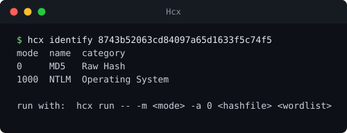

# Hcx


A wrapper around [hashcat](https://hashcat.net/hashcat/) that adds job management, reporting, attack planning, hash identification and tuning. It runs the stock `hashcat` binary and passes every original flag through unchanged. Standard library only.

> Use only on hashes you are authorized to recover.



## Features

- **Jobs**: every run is recorded with its command, session, progress, outcome and log, and can be resumed or queued
- **Reports**: parses the potfile or outfile, shows crack rate and password insights, exports CSV, JSON or HTML
- **Planner**: turns a target, wordlists and rules into an ordered plan (dictionary, rules, brute force or combinator)
- **Identify**: uses hashcat's `--identify`, with an offline heuristic as fallback
- **Tuning**: stores benchmark speeds, estimates keyspace and ETA for a mask, lists devices

`hcx run -- <anything>` is hashcat, with a managed session, a captured log, a shared potfile and a live dashboard on top.

## Install

Requires Python 3.8+ and a local `hashcat` build.

```bash
git clone https://github.com/Ernest-Kosmatko/Hcx.git
cd Hcx
pip install -e .
# or run in place:
python -m hcx --help
```

Hcx finds `hashcat` on `PATH`, next to itself or through `$HCX_HASHCAT`:

```bash
hcx config set-hashcat /path/to/hashcat.exe
hcx config show
```

## Usage

```bash
# identify a hash
hcx identify 8743b52063cd84097a65d1633f5c74f5

# run an attack, everything after -- goes to hashcat untouched
hcx run --name demo -- -m 0 -a 0 hashes.txt rockyou.txt -r rules/best64.rule

# history and results
hcx jobs
hcx report summary
hcx report export --source potfile --format html --out loot.html

# multi-step attack plan
hcx plan --hashfile hashes.txt --mode 0 \
    --wordlist rockyou.txt --rule rules/best64.rule --profile thorough --run

# hardware and timing
hcx benchmark -m 0
hcx devices
hcx eta --mask ?a?a?a?a?a?a?a?a --mode 0
```

Example session:

```
$ hcx run --name demo -- -m 0 -a 0 hashes.txt rockyou.txt -r rules/best64.rule
[*] Session: demo  |  Job: job_0007
  Progress ......: 41.2% (12,450,112 / 30,208,640)
  Speed .........: 1,842.3 MH/s
  Recovered .....: 3/5 hashes

$ hcx report summary
  Hashes cracked ..: 5
  Crack rate ......: 100%
  Top pattern .....: 8 chars, lowercase+digit
```

## Commands

| Command | Purpose |
|---|---|
| `run` | Run one attack, arguments after `--` go to hashcat |
| `queue add / list / run / clear` | Build and execute a sequential attack queue |
| `jobs` / `show` / `resume` / `rm` | Job history and session control |
| `report summary / potfile / job / export` | Results, statistics and exports |
| `plan` | Compose, queue or run a multi-step attack plan |
| `mask` | Generate a mask series with keyspace sizes |
| `identify` | Identify a hash mode |
| `benchmark` / `devices` / `eta` | Speed, hardware and time estimates |
| `config` | Show or change configuration |

## Project structure

```
Hcx/
├── hcx/
│   ├── cli.py        argparse and command dispatch
│   ├── jobs.py       command construction, run, queue, resume
│   ├── runner.py     subprocess handling, live dashboard, logging
│   ├── store.py      SQLite persistence for jobs and benchmarks
│   ├── report.py     potfile parsing, statistics, CSV/JSON/HTML export
│   ├── planner.py    attack plans and mask series
│   ├── identify.py   hashcat --identify and offline heuristic
│   ├── tuning.py     benchmark, devices, keyspace and ETA
│   ├── config.py     paths and hashcat discovery
│   └── util.py
├── pyproject.toml
└── README.md
```

## State

State lives in a per-user directory: `%APPDATA%\hcx` on Windows, `~/.local/share/hcx` on Linux, `~/Library/Application Support/hcx` on macOS. It holds a SQLite job database, logs, restore files, outfiles and a shared potfile. Override it with `$HCX_HOME` or `--home`. Nothing is written into the repository.

## Disclaimer

Hcx orchestrates hashcat and does not change what you are permitted to do with it. Recovering credentials you do not own or have no written authorization to test is illegal in most jurisdictions. The author assumes no liability for misuse.

## License

MIT. hashcat is a separate project under its own license.
